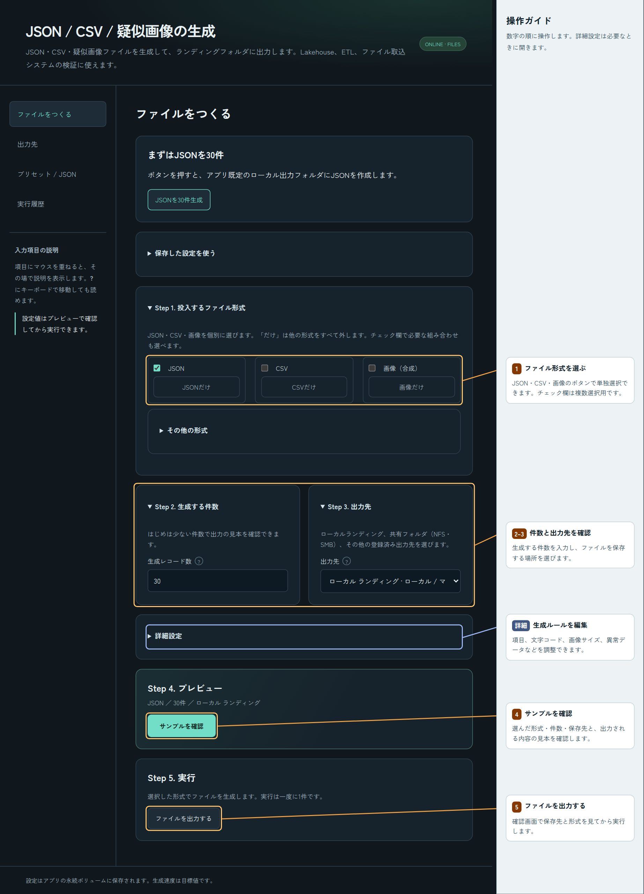

# ファイル生成ツール / JSON・CSV・画像・業務文書

CSVを30行作り、10行ずつ3ファイルに分ける手順を[初心者マニュアル](docs/user-manual.md)で確認できます。

## 起動して最初の画面を開く

Linux VMに Docker Compose を用意します。別端末からの接続やホスト側のマウントは[VM導入手順](docs/vm-compose.md)を参照してください。

```sh
python3 scripts/init_local.py --private-dir ./private --data-dir ./data --env-file .env
docker compose up -d --build
```

VMで `http://127.0.0.1:3561/` を開きます。メニューの「ヘルプ」から、見本の出し方、設定、APIを調べられます。 別端末から管理操作をする場合は[管理画面の認証](docs/vm-compose.md#管理画面の認証)も設定します。

開発時に直接起動する場合は Python 3.12〜3.14 と uv を使用します。必要なPythonは uv でインストールできます。

```sh
uv sync --frozen
DATA_DIR=./data uv run --frozen uvicorn app:app --host 127.0.0.1 --port 3561
```

## 操作と設定の資料

[8アプリの構成](docs/architecture.md)から役割と既定ポートを調べられます。

- [初心者マニュアル](docs/user-manual.md) · [ひな型を選ぶ・作る](docs/preset-guide.md) · [付属のひな型一覧](presets/README.md)
- [設定リファレンス](docs/settings-reference.md) · [JSONの書き方](docs/template-guide.md) · [AI向け作成ハーネス](docs/AI_TEMPLATE_HARNESS.md)
- [APIの使い方](docs/api-guide.md) · [用語集](docs/glossary.md) · [コードを拡張する](docs/code-reading-guide.md) · [変更履歴](CHANGELOG.md) · [レビュー対応表](docs/quality-review.md)

任意のデータ項目からJSON、CSV、人工的な検査パターン画像、XLSX、XML、Parquet、Avro、PDFを生成します。

| 接続方式 | 実装 |
| --- | --- |
| ローカル / マウント済み共有 | /landing等へ保存。構成例ではローカルのランディング領域を使用 |
| NFS | ホストで事前マウントしたNFSv3/v4をアプリへ渡す。実際のNFSマウントと任意のマウント元を検証 |
| SMB / Samba | SMB2/3で直接接続。ユーザー・ドメイン・パスワード、条件を整えたKerberos。暗号化を既定で要求 |
| FTP / FTPS | FTP、Explicit/Implicit FTPS、アクティブ/パッシブ、文字コード、ユーザー/匿名認証 |
| SFTP | SSHによる直接接続。パスワード、RSA/ECDSA/Ed25519鍵。known_hostsまたはSHA256によるホスト鍵検証 |
| S3互換 | R2等の既存バケットへ直接保存。明示的なアクセスキー認証 |

SMBとNFSは別方式です。SMBはアプリから直接接続します。NFSのマウントはホストで行い、compose.network-shares.yamlを使って/network/nfsへ渡せます。アプリ自体にはmount権限を与えません。FILE_ALLOWED_ROOTS（既定/landing:/network）の下へ保存します。NFS/共有側のUID/GIDとアプリUID1000を合わせてください。DockerイメージにはSMB Kerberos用GSSAPI拡張も含めます。利用には有効なチケットとドメイン設定が必要です。Dockerを使わず直接起動する場合はOSのKerberos開発パッケージを導入し、uv sync --extra kerberosで拡張を追加してください。

FTP/SFTP/SMBは一時ファイルの保存後に確定名へ変更します。JSON/CSV/画像を保存してから、SHA256・サイズ・レコードキーを含む.ready.jsonを最後に作成。下流はこの完了マニフェストを取り込みの目印にできます。ファイル名にはjob_id等を含め、他の書き込み処理と衝突させないでください。サーバー実装によってrenameの並行実行時の保証は異なります。S3では条件付きPutObjectを要求します。

JSONは配列・1件1ファイル・JSONL、任意の入れ子構造、整形、gzipを設定。CSVは区切り、引用規則、ヘッダー、NULL表現、改行、UTF-8/BOMを設定。画像は幅・高さ・PNG/JPEG・色・パターン・ノイズ・疑似欠陥率・間引きを設定します。画像は人工パターンで、外部の写真検索やAI生成APIは使用しません。

# Data Source Studio 共通仕様

各アプリは独立したコンテナと永続ボリュームを持ちます。設定は業種に依存しません。v2では接続プロファイル、任意のデータ項目、生成ルール、実行条件を画面で編集できます。

## 操作ガイド

[ひな型の選び方・詳細設定の画面・自分のひな型の作り方](docs/preset-guide.md)

[](docs/images/operation-guide.png)

「投入するファイル形式」と件数、出力先を選び、「サンプルを確認」を押します。生成ルールや文字コード、画像サイズ、異常データを変えるときは、出力先の下にある「詳細設定」を開きます。

初めての方は **「JSONを30件生成」** を押すと、アプリ既定のローカルランディングへJSONを1バッチ出力します。編集途中の内容・保存済みプリセット・外部プロトコルの出力先は使いません。ローカルとはアプリから見たパスであり、運用者がその領域自体を共有ストレージに割り当てることはできます。既定の出力先を別のフォルダや外部接続に変更している場合はお試し生成を停止し、通常の出力先選択へ案内します。

1. **投入するファイル形式**：新規画面ではすべて未選択です。「JSONだけ」「CSVだけ」「画像だけ」で単独選択、チェック欄で複数選択できます。選んだ形式のデータだけを出力します。Excel・XML・Parquet・Avro・PDFは「その他の形式」に残しています。
2. **生成する件数**：件数を設定します。「詳細設定」からシード値、生成速度、分割・命名を調整できます。更新率・削除率は任意のテスト用ラベル `file_event_operation`（`insert`・`update`・`delete`）の抽選確率です。合計100%以下。両方0%なら列を追加しません。データベースや既存ファイルへの更新・削除は行いません。独自JSONテンプレートを使う場合は必要に応じて `$row.file_event_operation` を明示してください。各実行の少量サンプルが指定割合と厳密に一致するとは限りません。
3. **出力先**：ローカルランディング、共有フォルダ（NFS・SMBなど）、その他の保存済み出力先を選びます。新しい出力先は「出力先」画面で登録できます。通常実行では、共有領域がローカルパスに見える場合も含め、保存済み出力先を実行前に確認します。
4. **プレビュー**：選択した形式・件数・出力先を確認できます。JSONとCSVは出力内容の一部、画像は形式・寸法・出力予定枚数を表示します。書き込み・外部通信は行いません。
5. **実行**：「ファイルを出力する」で出力先と形式を確認します。開始後は「実行履歴」で出力結果・停止・設定の再編集ができます。

画像の付帯JSONは新規設定では無効です。取り込み用の完了印は出力データの形式選択とは別に扱います。

独自の項目やプリセットを編集する手順は引き続き使えます。「この設定を保存…」でJSON編集へ進み、プリセットIDを指定して保存します。

プリセットには接続IDだけを保存します。パスワード、アクセストークン、SSH秘密鍵等は接続プロファイルへ暗号化保存し、読み戻しと書き出しには含めません。空欄は同じ接続先の既存値を維持し、接続先や認証方式が変わると以前の資格情報を引き継ぎません。明示的な削除はclear_secretsで指定します。

証明書やSFTPのknown_hosts等は接続先画面からconnection-filesへ配置できます。ファイル自体は権限600で保存します。これらのファイルと設定暗号鍵を含む永続ボリュームのバックアップは保護してください。公開リポジトリには保存しません。

## 自由なデータ定義

型はstring / integer / number / decimal / boolean / datetime / json。生成器はrecord_id、uuid、sequence、integer、uniform、normal、choice、boolean、constant、template、timestamp、reference、sum、difference、product、ratio。

日時はタイムゾーン付きISO形式を指定し、UTCへ変換します。decimalはJSONでは精度を保つ文字列です。テンプレートは`DEV-{entity_no:05d}`のような先行項目・共有値・sequence・record_idの参照に対応し、任意Pythonは実行しません。JSON構造テンプレートは`$row.項目` / `$parameters.名前` / `$meta.record_key`等を参照し、入れ子のオブジェクトと配列を定義できます。

項目名は英字/下線で始まる英数字/下線、63文字まで。1レコードのJSONは1MiBまで、1実行は1億レコードまでです。拡張契約は`contracts/preset.schema.json` / `contracts/connection.schema.json`にあります。

## 大量生成

62種類の編集可能なJSONプリセットを同梱。通常24種類、MES/ERP等の異常24種類、業務ファイル14種類を用意。少量・大量生成、分布・派生値・書式に加え、固着・ドリフト・時刻ずれ・数量不整合・処理障害等を設定できます。件数、開始位置、乱数seed、目標速度、バッチ件数、時間・容量上限、初期待機、ゆらぎ、バースト件数・待機を変更できます。目標速度0は速度制限なし。実速度は生成内容・接続先・ディスクに依存します。

実行は各ツール1件ずつ。全件をメモリには保持せず、行サイズに合わせてバッチを縮小します。ホストのメモリ余力・ディスク余力を監視し、閾値に達した場合は停止します。設定と履歴は永続化し、プロセス再起動で中断された実行はinterruptedになります。実行開始時に接続プロファイルの版を固定します。

## APIと検証

管理APIの例: `/api/info`、`/api/schemas`、`/api/connections`、`/api/presets`、`/api/preview`、`/api/runs`。プロファイル保存後の`/api/connections/{id}/test`は保存済み設定を検証します。`/healthz` は稼働確認、`/metrics` は管理用のメトリクスです。UIとAPIの変更操作は同一オリジンとJSONを要求します。

```sh
uv run pytest -q
uvx ruff check .
```

過去の実行履歴・設定・出力ファイルは保持します。旧設定に含まれる他のツール向けの欄は、ファイル生成の画面には表示しません。

実接続のスモークテストは FILE_TEST_PROFILES_FILE に非公開の接続プロファイル配列JSONを指定して実行できます。検証用の配送先を用意し、資格情報ファイルはGitへ追加しないでください。

プリセットの再生成は `uv run python scripts/build_presets.py --kind files`。新規プリセットだけを初回起動時に登録し、保存済みプリセットを更新で上書きしません。

## 異常シナリオと説明

プリセット選択時には、想定状況・発生データとタイミング・確認事項・実行条件を表示します。既存の通常プリセットにも説明を用意しています。異常ルールは正常行の生成後に適用し、対象の項目、適用開始/終了位置、頻度、確率、比較条件を変更できます。ルールは上から順に適用します。

データの異常があるだけでジョブが失敗するとは限りません。不整合な模擬データを取り込み側の品質チェックで検知できるか試験します。型や必須項目の不正、処理障害のプリセットでは意図的にfailedで終了するケースもあります。

処理障害はこの実行だけの例外・待機で再現し、外部サーバーを停止したりネットワーク設定を変更しません。ファイルは完了前に止めると取り込み用のready.jsonが作成されません。

他アプリとの組み合わせや、SECS/GEMなどの検討中の方式は[データソースの構成と拡張候補](docs/source-roadmap.md)を参照してください。

## 業務ファイルの追加形式

XLSXは列順・シート名を設定し、文字列を既定で数式として実行しない形で保存。XMLはUTF-8、ルートと行の要素名、NULL属性を指定。Parquetは列型を明示しSnappy/Gzip/Zstandard/無圧縮を選択。Avroはnullable型・decimal・UTC時刻のスキーマを同梱しdeflate/無圧縮を選択。PDFは日本語対応の複数ページの表で、列選択・縦横・フォントサイズを設定できます。

JSON/CSV/画像と同じバッチの.ready.jsonに、追加形式のサイズ・SHA256も記録します。CSVやXLSXの小数は文字列として保持する一方、Parquet/Avroではdecimal型に変換します。画像は人工パターン、PDFはデータ表であり、実際の検査装置の書式をそのまま再現するものではありません。

業務ファイルプリセットの再生成: `uv run python scripts/build_document_presets.py`。追加済みの設備・API・ヒストリアン・ログ・RFIDツールは[データソース構成](docs/architecture.md)を参照してください。

## 外部監視用の管理ラベル

Composeの管理ラベルは既定で `factory.guard.managed=true` です。外部監視側との合意が必要な場合は、非公開の配備設定で `FACTORY_GUARD_LABEL_PREFIX` を指定できます。例えば説明用の値 `synthetic-guard` を指定すると、`synthetic-guard.guard.managed=true` になります。

既存の外部監視との互換性は未確認です。変更前に監視側が照合するラベル名と影響を確認してください。この設定は既存コンテナや監視設定を自動移行せず、デプロイも行いません。

## ライセンス

アプリ本体は[MITライセンス](LICENSE)です。同梱フォントとSwagger UIのライセンスは各配布ディレクトリにあります。
