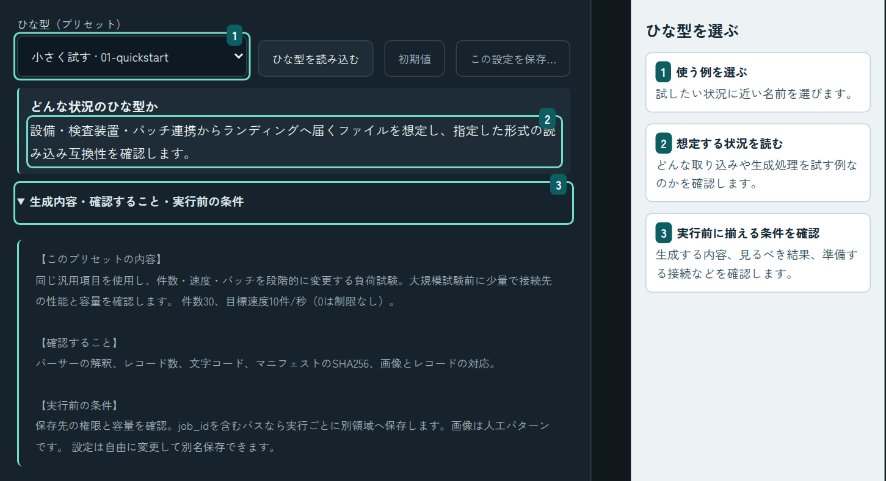
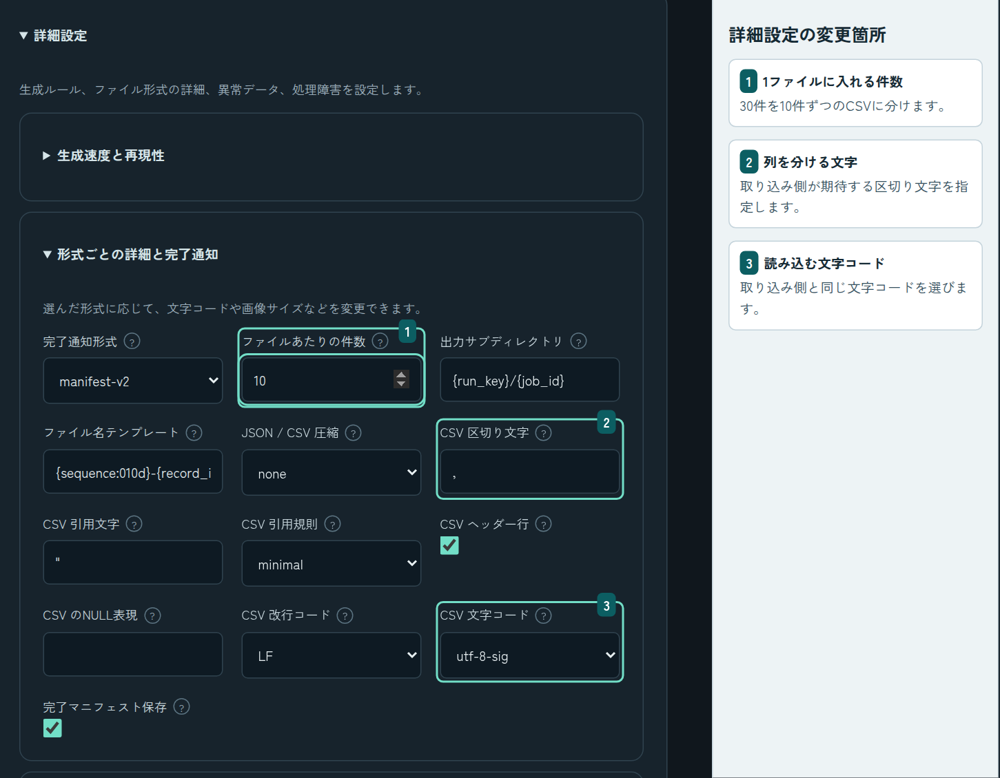
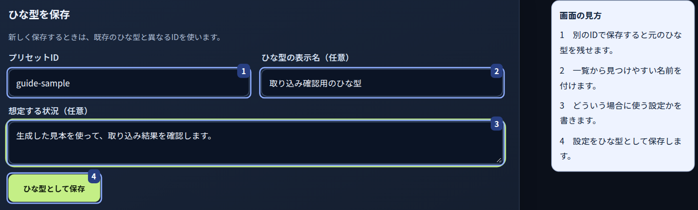
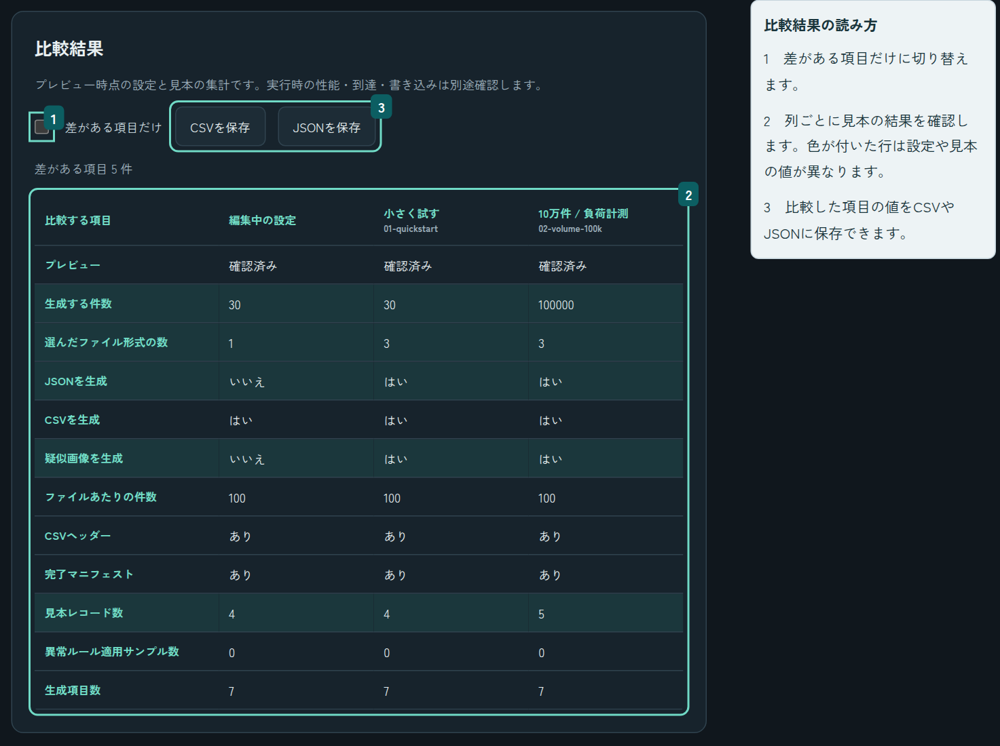

# ファイル生成のひな型と詳細設定

ひな型（プリセット）は、生成するデータの項目・件数・書式や、再現したい異常をまとめた設定です。試したい状況に近いひな型を読み込み、見本を確認してから必要な設定を変えます。公開、書き込み、送信を始めるときは、画面の実行ボタンを使います。

## ひな型を選ぶ

**小さく試す（01-quickstart）** を例にします。

設備や検査装置のCSVをフォルダから取り込む試験です。最初は少量で、列、文字コード、ファイルの分割を調べます。

「保存した設定を使う」を開き、「小さく試す」を選んで「ひな型を読み込む」を押します。「CSVだけ」を選び、件数を30にします。

「どんな状況のひな型か」で用途を確認し、「生成内容・確認すること・実行前の条件」で作るデータや準備を読みます。

「10万件 / 負荷計測（02-volume-100k）」は、保存先の容量を確保し、処理量を測るときに使います。

全ひな型の用途は[プリセット一覧](../presets/README.md)を参照してください。

## 詳細設定を変更して見本を見る

「詳細設定 → 形式ごとの詳細と完了通知」を開き、「ファイルあたりの件数」を10にします。試験用のローカル出力先を選びます。

| 設定 | 変えられること |
| --- | --- |
| ファイルあたりの件数 | CSVを出力するとき、1ファイルに入れるレコード数です。 |
| CSV 区切り文字・CSV 文字コード | 取り込み側が想定する区切りと文字コードに合わせます。 |
| 完了通知形式 | 取り込み側が出力完了を判断する方式を設定します。 |

**見本での確認**　「サンプルを確認」でCSVのヘッダーと値を見ます。隔離したローカル出力先へ実行した場合は、データCSVが3ファイルに分かれたことを確認できます。取り込みの完了印は別のファイルです。

## 自分のひな型を作って保存する

1. 上の例で編集した設定を残すには、「この設定を保存…」を押します。今の設定がJSON欄に入った保存画面が開きます。
2. 「プリセットID」に `guide-csv-30-by-10` のような新しいIDを入力します。半角英数字、ハイフン、下線が使えます。同じIDで保存すると、そのひな型を更新します。
3. 必要に応じて表示名と想定する状況を入力し、「ひな型として保存」を押します。画面で編集した設定は、JSON欄を書き直さず保存できます。
4. 生成画面の「保存した設定を使う」に戻り、新しく保存したIDを選んで「ひな型を読み込む」を押します。見本を出し、変更した条件が戻っていることを確認します。

たとえばCSVの区切り文字で取り込み結果が変わるか比べる場合は、上のひな型を読み込み、「CSV 区切り文字」だけを変更します。「ファイルあたりの件数」は `10` のままにして見本のヘッダーと列の区切りを確認し、区切り文字ごとに別のIDで保存します。

共有するひな型には「CSV 30件・10件で分割」のような表示名と、「CSVの取り込み側が分割ファイルを順に読めるか確認する。」のような用途を書いておくと、次の人が選びやすくなります。接続先と認証は「出力先」で管理します。ひな型を別環境で使う場合は「JSONを書き出す」で持ち出し、利用先で接続設定を選び直します。

## 複数のひな型を比較する

メニューの「見本を比較」を開きます。ファイル形式、件数、分割と取り込み完了の設定を比べます。

1. 「名前・ID・用途」にキーワードを入力します。よく使うひな型は「お気に入り」を押すと、このブラウザーの「お気に入りのみ」で絞り込めます。「編集画面で選ぶ」を押すと、編集画面でそのひな型が選ばれます。「ひな型を読み込む」を押すと編集欄へ反映されます。
2. 比べたいひな型を最大3件選びます。画面で編集した設定も比べる場合は「編集中の設定を含める」をオンにします。検索条件を変えても選択は維持され、下の「比較する条件」に選んだIDが残ります。編集中の設定を含めるときは、先にファイル形式を1つ以上選びます。
3. 「見本を比較」を押します。複数の候補を順番にプレビューします。「残りを中止」を押すと、処理中のプレビューが終わった時点で残りを止めます。「要確認」の候補は編集画面で設定を見直し、通常のプレビューで詳細を確認します。
4. 比較結果は「差がある項目だけ」で絞り込めます。「CSVを保存」または「JSONを保存」で、ひな型ID・確認状況・比較項目の値を記録できます。接続情報や生成した本文は比較ファイルに含まれません。対象の設定を変えたら比較をやり直します。

[操作ガイドに戻る](../README.md#操作ガイド)
