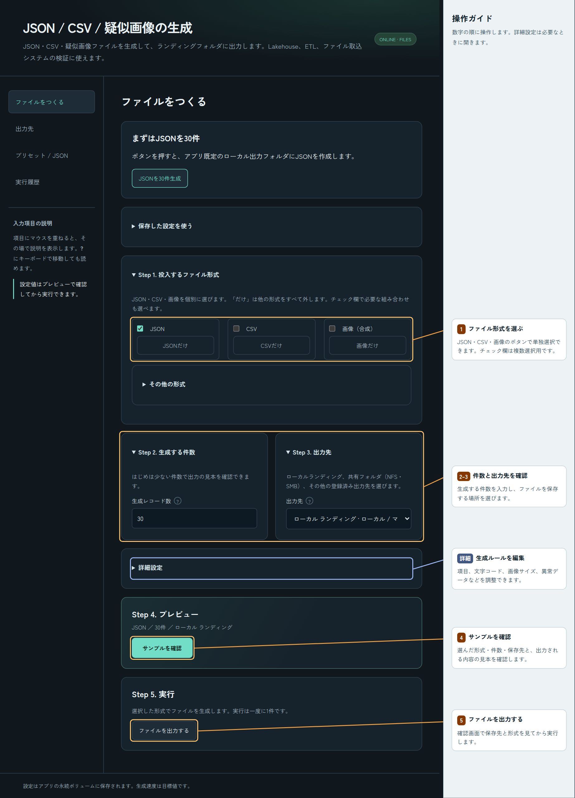

# ファイル生成ツール 操作マニュアル

取り込み側がファイル形式、分割、完了通知を解釈できるか検証します。指定件数の合成データをJSON・CSV・疑似画像などにし、ランディング領域へまとめて書き出します。

## 起動してから結果が出るまで

プレビューは見本と出力先を確認する段階です。実行するとジョブが作られ、出力先と形式に応じてファイルを作り、設定に応じてマニフェストを置きます。

## まず小さく試す

VMで準備する場合は[Docker Compose導入手順](vm-compose.md)で起動し、Web画面を開きます。

1. 「CSVだけ」を選び、件数を30にします。「詳細設定」でファイルあたりの件数を10にすると、同じ形式のファイルを数本に分割する試験ができます。
2. 出力先をローカルランディングにし、「サンプルを確認」でヘッダー、区切り、文字コード、書き込み先を確認します。
3. 実行前の確認で出力先を照合し、「ファイルを出力する」を押します。「実行履歴」でジョブの進捗と出力一覧を確認し、VMで `.env` の `LANDING_DIR` を開いてCSVの件数を照合します。
4. 取り込み側が書き込み途中のファイルを読まないよう、完了マニフェストの種類と対応する受け取り方式を揃えます。画像だけを選んだ場合、標準設定で付随JSONを作らず画像を確認できます。

## 停止と再起動

ジョブは完了すると停止します。途中停止を選んだ場合は部分出力が残ることがあるため、取り込み側で完了印を確認します。

## 想定した結果が出ないとき

実行履歴が失敗の場合は出力先の権限と空き容量を先に確認します。ファイルが見えてもマニフェストのないバンドルは、マニフェスト待ちの収集では未完了の扱いです。

## ひな型・詳細設定

[ひな型を作る・見本を比較する](preset-guide.md)には設定例と注釈付き画像があります。各ひな型の一覧は[プリセット一覧](../presets/README.md)にあります。
